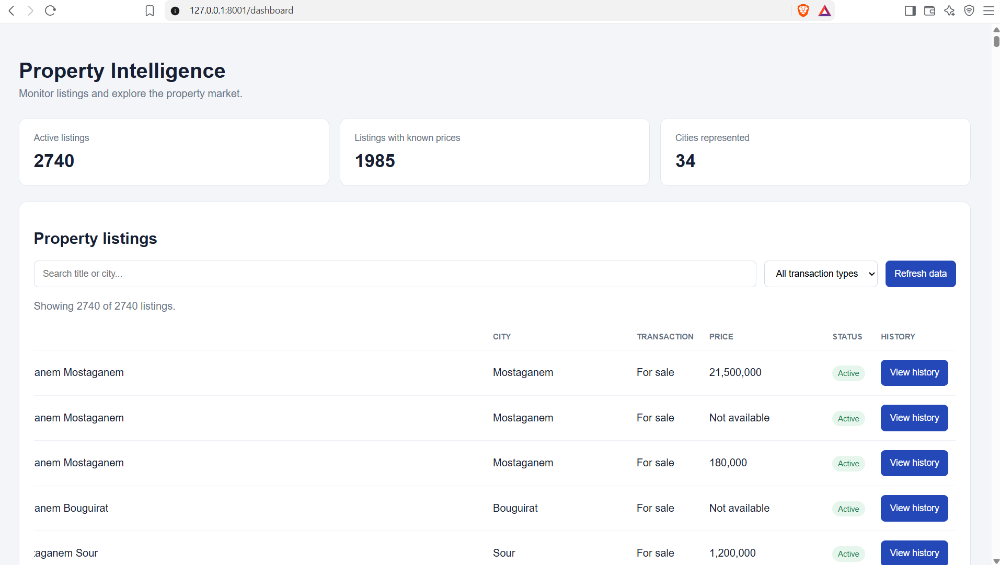

# Property Listing Intelligence

A Python-based property listing monitoring system that collects real estate listings from Ouedkniss, stores them in SQLite, detects new listings and price changes, and presents the results through an interactive web dashboard.

The project demonstrates practical skills in data collection, database management, change detection, API development, analytics, and automated testing.

## Dashboard Preview




*The dashboard provides a browser-based interface for exploring collected property listings and monitoring results.*

## Features

- **Live data collection:** Retrieve property listings using the Ouedkniss GraphQL API.
- **SQLite persistence:** Store collected listings and monitoring events locally.
- **New listing detection:** Identify listings that were not present in the existing database records.
- **Price change detection:** Detect price changes and prices becoming available or unavailable.
- **Event logging:** Record detected changes with timestamps and listing details.
- **Web dashboard:** Explore project data through a browser-based interface.
- **REST API:** Serve application functionality through FastAPI.
- **Market analytics:** Analyze collected property listing data.
- **Automated testing:** Validate key functionality with pytest.

## Tech Stack

| Technology | Purpose |
|---|---|
| Python | Application logic and data processing |
| Requests | HTTP requests to the Ouedkniss API |
| SQLite | Local database storage |
| FastAPI | API and web application backend |
| Uvicorn | Local application server |
| HTML, CSS, JavaScript | Dashboard interface |
| Pytest | Automated testing |

## Project Structure

```text
property-monitor/
├── app.py
├── collector.py
├── monitor.py
├── database.py
├── analytics.py
├── test_collector.py
├── test_monitor.py
├── test_monitor_safety.py
├── test_database.py
├── test_analytics.py
├── requirements.txt
├── screenshots/
│   └── dashboard.png
└── README.md
```

## Getting Started

### Prerequisites

- Python 3.10 or newer, subject to dependency compatibility.
- An internet connection for collecting live listings.

### 1. Clone the repository

```bash
git clone https://github.com/ounnes-dev/property-listing-monitor.git
cd property-listing-monitor
```

### 2. Create a virtual environment

```bash
python -m venv .venv
```

Activate it on Windows PowerShell:

```powershell
.venv\Scripts\Activate.ps1
```

### 3. Install dependencies

```bash
python -m pip install -r requirements.txt
```

### 4. Start the dashboard and API

```bash
python -m uvicorn app:app --reload --port 8001
```

Open the following URLs in your browser:

- **Dashboard:** http://127.0.0.1:8001/dashboard
- **Interactive API documentation:** http://127.0.0.1:8001/docs

Keep this terminal running while using the dashboard.

### 5. Run the monitoring process

Open a second terminal, activate the virtual environment, and run:

```powershell
python monitor.py
```

The monitoring process collects listings, compares them with existing database records, records detected events, and saves the current results.

By default, the collector checks a limited number of pages. You can configure this using the `PROPERTY_MONITOR_MAX_PAGES` environment variable.

PowerShell example:

```powershell
$env:PROPERTY_MONITOR_MAX_PAGES = "3"
python monitor.py
```

The number of listings collected depends on the number of results returned by the source.

**Note:** Listings missing from a limited collection are not automatically classified as removed. A listing may simply be outside the pages collected during that run.

### 6. Run the automated tests

```powershell
pytest -q
```

## Data Storage

The application uses a local SQLite database to store property listings and monitoring events. Database tables are initialized by the application, and the database file is generated locally.

The database and other generated data files are not required to clone the source code and should generally remain outside version control.

## Project Goals

This project was built to explore practical applications of:

- Collecting data from an external API.
- Normalizing and processing real-world data.
- Persisting records in a relational database.
- Detecting changes between successive data collections.
- Developing a backend and browser-based dashboard.
- Analyzing property listing data.
- Testing application behavior and failure cases.

## Future Improvements

- Scheduled monitoring.
- Configurable cities and property categories.
- More advanced property-market analytics.
- Historical price trend visualizations.
- Notifications for significant listing changes.
- Deployment to a hosted environment.

## Author

**Barae Ounnes**

[GitHub](https://github.com/ounnes-dev)
